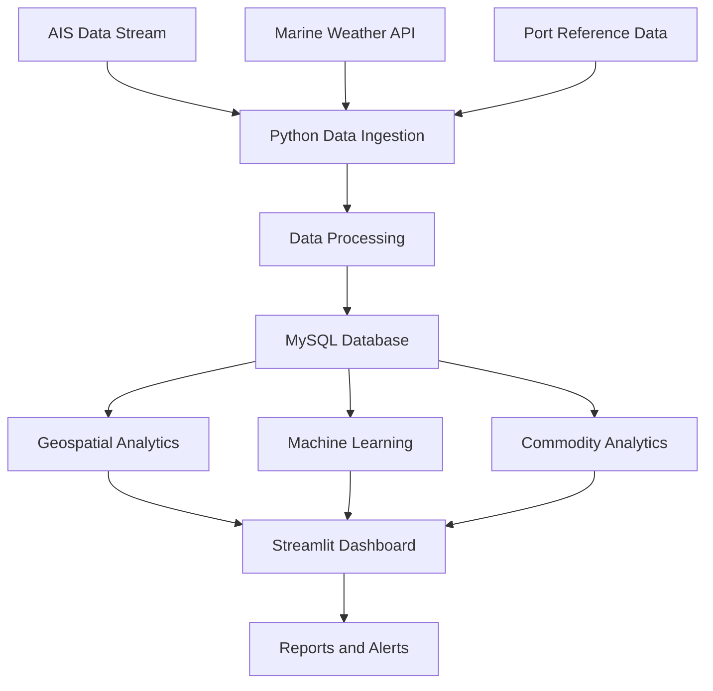

# Global Vessel Intelligence System (GVIS)


## Project Overview

The Global Vessel Intelligence System (GVIS) is an end-to-end maritime intelligence platform designed to transform vessel movement data into actionable insights for shipping, logistics, supply chain management and commodity trading.

The project combines AIS data, geospatial analytics, machine learning, database management and automated reporting.

## Project Objectives

- Monitor global vessel movements and maritime traffic.
- Identify port congestion and operational bottlenecks.
- Predict vessel arrival times and potential delays.
- Analyse maritime commodity flow patterns.
- Detect abnormal vessel behaviour.
- Automate maritime intelligence reporting.

## Core Modules

| Module | Description |
|---|---|
| Vessel Tracking | Live AIS data ingestion and historical vessel tracking |
| Port Congestion | Geofencing, waiting times and port turnaround analysis |
| ETA Prediction | Machine learning-based arrival time estimation |
| Commodity Intelligence | Crude oil tanker and LNG carrier movement analysis |
| Maritime Risk | Anomaly detection and disruption monitoring |
| Intelligence Dashboard | Interactive maps, KPIs and automated reporting |

## System Architecture



## Technology Stack

| Category | Technologies |
|---|---|
| Programming | Python 3.11 |
| Database | MySQL, SQLAlchemy |
| Data Engineering | Pandas, NumPy, WebSockets |
| Geospatial Analytics | GeoPandas, Shapely, Geopy |
| Machine Learning | Scikit-learn, XGBoost |
| Visualisation | Plotly, Matplotlib, Seaborn |
| Interactive Mapping | Folium, PyDeck |
| Web Application | Streamlit |
| Testing | Pytest |
| Automation | Windows Task Scheduler |
| Version Control | Git, GitHub |

## Planned Data Sources

- AISStream
- MarineCadastre
- IMF PortWatch
- Open-Meteo
- World Port Index
- EIA
- UN Comtrade

Data availability, coverage and licensing will be evaluated during development.

## Repository Structure

```text
global-vessel-intelligence/
├── config/
├── data/
│   ├── raw/
│   ├── processed/
│   └── reference/
├── notebooks/
├── src/
│   ├── ingestion/
│   ├── preprocessing/
│   ├── analytics/
│   ├── models/
│   └── reporting/
├── sql/
├── dashboard/
├── tests/
├── models/
├── reports/
├── logs/
├── .env.example
├── .gitignore
├── requirements.txt
├── LICENSE
└── README.md
```

## Development Roadmap

- [ ] Phase 1 - Project Initialisation and AIS Data Collection
- [ ] Phase 2 - Database Design and ETL Pipeline
- [ ] Phase 3 - Interactive Vessel Tracking
- [ ] Phase 4 - Port Congestion Analytics
- [ ] Phase 5 - Machine Learning ETA Prediction
- [ ] Phase 6 - Commodity Flow Intelligence
- [ ] Phase 7 - Maritime Risk and Anomaly Detection
- [ ] Phase 8 - Streamlit Intelligence Dashboard
- [ ] Phase 9 - Automated Reporting and Monitoring
- [ ] Phase 10 - Deployment and Documentation

## Installation

```bash
git clone https://github.com/ShinyDratini/global-vessel-intelligence.git
cd global-vessel-intelligence

conda create -n gvis python=3.11 -y
conda activate gvis

pip install -r requirements.txt
```

Create a local `.env` file using `.env.example` and configure the required credentials.

## Industry Applications

- Maritime operations and vessel monitoring
- Port and terminal operations
- Freight forwarding and logistics
- Supply chain risk management
- Commodity trading and market intelligence
- Energy transportation analytics

## Future Enhancements

- Deep learning vessel trajectory prediction
- Global maritime trade network analysis
- Commodity price and vessel flow correlation modelling
- Vessel routing and voyage cost optimisation
- AI-generated maritime intelligence briefings
- Cloud-based real-time streaming architecture

## Author

Developed as an independent portfolio project combining professional logistics and supply chain experience with postgraduate training in data analytics.

## Disclaimer

This project is intended for educational, research and portfolio purposes. It is not intended for navigational, commercial trading or safety-critical operational decisions. AIS data may contain inaccuracies, missing observations and reporting delays.

## License

This project is licensed under the MIT License.